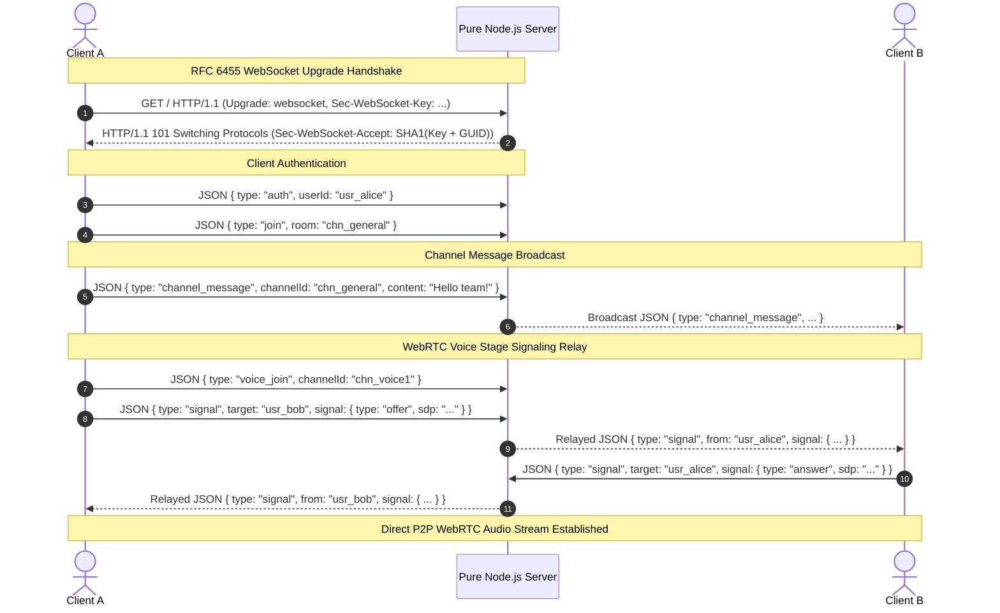
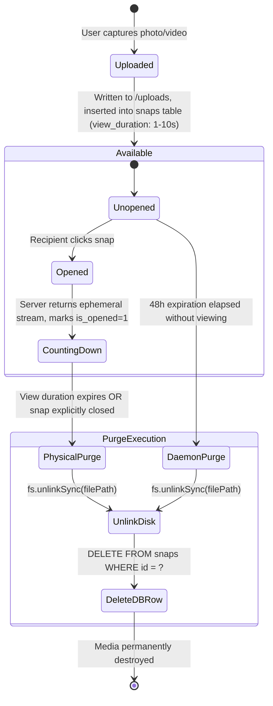

# INSAY SOCIAL NETWORK ECOSYSTEM — SYSTEM ARCHITECTURE SPECIFICATION

**Author:** Autonomous Principal Software Architecture & Engineering Team  
**Document Version:** 1.0.0  
**Target Runtime:** Node.js >= 22 (macOS, Linux, Docker)  

---

## 1. Architectural Philosophy & Ecosystem Boundary

The INSAY ecosystem is engineered according to a **Federated Independent Services** model rather than a forced distributed monolith or a shared-database anti-pattern. 

### Why Avoid a Shared Monolithic Database?
1. **Divergent Lifecycles**: A camera-first ephemeral platform (`insaysnap`) requires aggressive, irreversible disk and database row deletions; in contrast, a community platform (`insaybook`) requires archival group discussions and permanent event records. Combining these into a single database schema creates contention, fragile migrations, and accidental data exposure.
2. **Independent Deployability**: Each platform can be packaged, scaled, or migrated without impacting the uptime or performance of the other four platforms.
3. **Operational Simplicity**: Each platform runs on its own dedicated embedded SQLite database in Write-Ahead Logging (WAL) mode, requiring zero external server configuration, zero connection pool timeouts, and offering microsecond query execution.

```mermaid
graph TD
    User([Browser Client])

    subgraph Port 4173 [INSAYGRAM - Visual Network]
        S1[Node.js HTTP & WS Server]
        DB1[(insaygram.db - WAL)]
        UP1[Media Uploads: Photos & Reels]
        S1 --> DB1
        S1 --> UP1
    end

    subgraph Port 4174 [INSAYBOOK - Communities]
        S2[Node.js HTTP Server]
        DB2[(insaybook.db - WAL)]
        UP2[Media Uploads: Post Attachments]
        S2 --> DB2
        S2 --> UP2
    end

    subgraph Port 4175 [INSAYSNAP - Ephemeral]
        S3[Node.js HTTP Server]
        DB3[(insaysnap.db - WAL)]
        UP3[Ephemeral Vault: Auto-Destruct]
        DAEMON[3-Second Purge Daemon]
        S3 --> DB3
        S3 --> UP3
        DAEMON --> DB3
        DAEMON --> UP3
    end

    subgraph Port 4176 [INSAYTOK - Short Video]
        S4[Node.js HTTP Server]
        DB4[(insaytok.db - WAL)]
        UP4[Video Media: MP4/WebM]
        ALGO[Explainable Scoring Engine]
        S4 --> DB4
        S4 --> UP4
        S4 --> ALGO
    end

    subgraph Port 4177 [INSAYCORD - Real-Time Chat]
        S5[Node.js HTTP & WS Server]
        DB5[(insaycord.db - WAL)]
        SIG[WebRTC Audio Signaling Relay]
        S5 --> DB5
        S5 --> SIG
    end

    subgraph Port 4178 [INSAYTUBE - Long-Form Video]
        S6[Node.js HTTP Server]
        EQUAL[Multi-Algorithm Equalizer]
        PROXY[SSRF YouTube Proxy]
        S6 --> EQUAL
        S6 --> PROXY
    end

    User -->|HTTP / WS| S1
    User -->|HTTP| S2
    User -->|HTTP| S3
    User -->|HTTP| S4
    User -->|HTTP / WS / WebRTC| S5
    User -->|HTTP| S6
```



---

## 2. Reusable Engineering Core (`packages/core/`)

Each platform bundles five foundational modules that eliminate third-party npm runtime dependencies while guaranteeing production standards:

```
packages/core/
├── auth.js       # Scrypt key derivation, 256-bit sessions, HttpOnly cookies
├── db.js         # Native node:sqlite DatabaseSync, WAL mode, migrations runner
├── realtime.js   # RFC 6455 WebSocket framing, pub/sub rooms, WebRTC signaling
├── security.js   # CSP, anti-clickjacking, traversal guards, sliding-window rate limiter
└── uploads.js    # Streaming multipart parser, magic byte verification, HTTP 206 range streaming
```

### 2.1 Database Layer (`db.js`)
- Utilizes Node 22 native `node:sqlite` (`DatabaseSync`).
- Configures SQLite pragmas on initialization:
  ```sql
  PRAGMA journal_mode = WAL;
  PRAGMA foreign_keys = ON;
  PRAGMA synchronous = NORMAL;
  ```
- Implements transactional schema migrations tracking executed migrations in `_migrations`.

### 2.2 Security & Authentication Layer (`auth.js` & `security.js`)
- **Key Derivation**: `crypto.scryptSync(password, salt, 64, { N: 16384, r: 8, p: 1 })`.
- **Timing-Safe Comparison**: `crypto.timingSafeEqual` prevents timing attacks on password verification.
- **Session Tokens**: 256-bit cryptographically secure random tokens (`crypto.randomBytes(32).toString('hex')`).
- **Path Traversal Protection**: Explicitly detects and rejects any URI containing `..` or leading `/` before path resolution.
- **Sliding-Window Rate Limiting**: In-memory ring buffer tracking client IP request timestamps over configurable time windows.

---

## 3. Real-Time WebSocket & WebRTC Architecture (`realtime.js`)

Used in **INSAYCORD** (Port 4177) and **INSAYGRAM** (Port 4173).



### WebSocket Frame Handling
- **Masking**: Conforms strictly to RFC 6455 Section 5.3. Client frames are masked using a 4-byte key; server decodes payloads using XOR unmasking:
  $$\text{unmasked}[i] = \text{payload}[i] \oplus \text{mask}[i \pmod 4]$$
- **Control Frames**: Automatically responds to Ping frames (Opcode `0x9`) with Pong frames (Opcode `0xA`).
- **Broadcasting**: Thread-safe room multiplexing (`Map<room, Set<client>>`) allowing instant broadcasts without cross-room leakage.

---

## 4. Ephemeral Media Lifecycle Architecture (INSAYSNAP)

Unlike typical prototypes that merely add `display: none` in CSS when a timer runs out, INSAYSNAP enforces **physical disk and database deletion**:



1. **Immediate Purge on Consumption**:
   When the recipient opens and finishes viewing a direct snap, the client sends confirmation (or the stream ends), triggering:
   ```javascript
   if (fs.existsSync(filePath)) fs.unlinkSync(filePath);
   db.run('DELETE FROM snaps WHERE id = ?', snapId);
   ```
2. **Background Scrub Daemon**:
   An autonomous daemon runs every 3 seconds inside `apps/insaysnap/server.js` inspecting `snaps` and `stories`:
   ```javascript
   const expired = db.all('SELECT * FROM snaps WHERE expires_at < ?', Date.now());
   for (const item of expired) {
     if (fs.existsSync(item.media_path)) fs.unlinkSync(item.media_path);
     db.run('DELETE FROM snaps WHERE id = ?', item.id);
   }
   ```

---

## 5. Explainable Recommendation Engine Architecture (INSAYTOK)

INSAYTOK replaces pseudo-random feeds with a deterministic, multi-factor recommendation algorithm (`apps/insaytok/src/server/recommendation.js`).

### Mathematical Formulation
For any candidate video $v$ and viewing user $u$:

$$\text{FinalScore}(u, v) = w_{\text{tag}} S_{\text{tag}}(u, v) + w_{\text{vel}} S_{\text{vel}}(v) + w_{\text{rec}} S_{\text{rec}}(v) - P_{\text{fatigue}}(u, v)$$

Where weights are configured as:
- $w_{\text{tag}} = 0.40$ (User Tag Affinity)
- $w_{\text{vel}} = 0.35$ (Viral Velocity)
- $w_{\text{rec}} = 0.25$ (Recency Decay)

#### 1. Tag Affinity Score $S_{\text{tag}}(u, v)$
Measures how closely the video's hashtags match the user's historical engagement profile:
$$S_{\text{tag}}(u, v) = \min\left(1.0, \sum_{t \in \text{tags}(v)} \text{Affinity}(u, t) \times 0.20\right)$$

#### 2. Viral Velocity Score $S_{\text{vel}}(v)$
Measures engagement intensity relative to views:
$$S_{\text{vel}}(v) = \min\left(1.0, \frac{\text{Likes} \times 2 + \text{Comments} \times 3 + \text{Shares} \times 4}{\max(\text{Views}, 1) \times 0.50}\right)$$

#### 3. Recency Decay Score $S_{\text{rec}}(v)$
Exponential time decay prioritizing fresh content with a 72-hour half-life:
$$S_{\text{rec}}(v) = e^{-\lambda \Delta t}, \quad \text{where } \lambda = \frac{\ln(2)}{72 \text{ hours}}$$

#### 4. Creator Diversity Penalty $P_{\text{fatigue}}(u, v)$
Prevents monopolization of the feed by a single creator. If user $u$ has seen $k$ videos from creator $C(v)$ in the past 24 hours:
$$P_{\text{fatigue}}(u, v) = \min(0.50, k \times 0.15)$$

---

## 6. High-Performance Media Pipeline (`uploads.js`)

### 6.1 Magic Byte Verification
Incoming uploads are inspected for cryptographic file signatures to block malicious executable uploads disguised as media:

| Format | Magic Byte Signature | Validated MIME |
|---|---|---|
| **JPEG** | `FF D8 FF` | `image/jpeg` |
| **PNG** | `89 50 4E 47 0D 0A 1A 0A` | `image/png` |
| **GIF** | `47 49 46 38` (`GIF8`) | `image/gif` |
| **WebP** | `52 49 46 46 .... 57 45 42 50` (`RIFF....WEBP`) | `image/webp` |
| **MP4** | `.... 66 74 79 70` (`ftyp`) | `video/mp4` |
| **WebM** | `1A 45 DF A3` | `video/webm` |

### 6.2 HTTP 206 Partial Content Range Streaming
Large video files in INSAYTOK, INSAYGRAM, and INSAYBOOK are served with standard HTTP Range support:
1. Inspects `Range: bytes=start-end` request header.
2. Calculates exact byte offset and chunk length.
3. Responds with status `206 Partial Content`, `Accept-Ranges: bytes`, `Content-Range: bytes start-end/total`.
4. Uses `fs.createReadStream(path, { start, end })` to stream binary slices with minimal RAM footprint.

